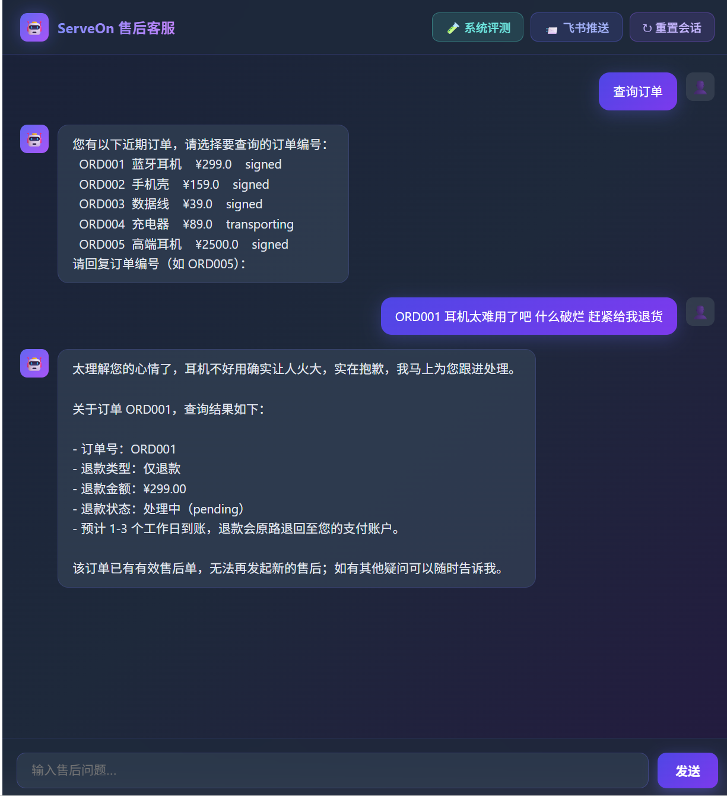
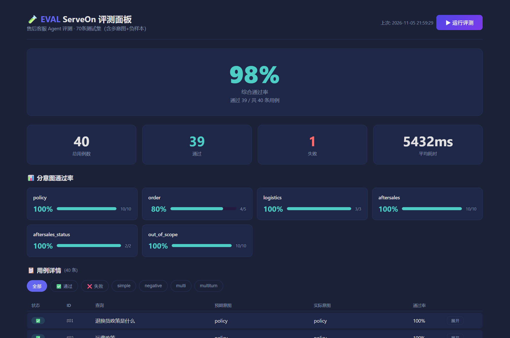

# ServeOn 电商智能平台

基于 **ReAct 主循环** 的电商智能平台，包含两大能力：
1. **智能客服 Agent**：面向电商平台售后场景，承接政策咨询、订单物流查询、退货退款申请三类诉求。v2 将主 Agent 重构为极简骨架（ReAct 工作模式 + 4 步思考流程），具体功能规则拆分为 3 个 skill 按输入特征按需注入，模型自主调用工具、据工具返回作答，高风险场景保守触发转人工；
2. **选品策略推送**：自动采集亚马逊/Walmart/eBay 商品数据，经 LLM 分析生成选品策略报告，自动推送飞书群。

回归样本共 **224 条**（边界 40 / 常规 99 / 测试 85），当前全量通过率 **92.0%**（206 PASS / 18 FAIL）。评测结果与逐条修复记录见 `logs/`。
## 功能特性

| 模块 | 能力 |
|------|------|
| 情绪分析与安抚 | 识别 calm/upset/angry 三档情绪，激动时先安抚再处理业务（F1） |
| 政策查询 | 模型按用户问题判断主题，调 `search_policy(topic=…)` 检索政策库，命中返回条款原文并引用出处；未命中由工具输出统一未收录口径（不转人）（F2） |
| 订单物流查询 | 查询订单状态、物流轨迹、预计送达（F3） |
| 售后进度查询 | 查询已发起售后单的处理进度（F4） |
| 退货退款申请 | 资格判定前置，引导完成退款全流程；未签收软阻断（签收后办理/可改仅退款）、超期/特殊商品/海外不支持答复（不转人） |
| 多意图识别 | 一句话多诉求并行/串行调度，如"退货退款+查物流"（3.0.1） |
| 指代消解与多轮上下文 | 槽位跨轮继承、模糊指代解析为具体订单号；信息缺失时追问，用户提供后自动组合原问题继续（3.0.2） |
| 转人工 | 仅 3 种：金额超 2000 元、用户点名、系统异常重试后仍失败；其余限制判定按不支持答复处理（F5） |
| skill 按需注入 | 骨架常驻 + 3 个 skill（query/policy/aftersales）按输入特征注入，纯政策咨询与售后申请分别携带最小必要规则 |
| 双层重试 | 模型侧：参数不合法 need_args 打回，最多 2 次；系统侧：工具执行失败自动重试最多 2 次，仍失败转人 |
| 飞书推送 | 子项目 `gui/cross-border-scout`：选品策略报告自动推送飞书群 |

## 技术栈

- **编排**：ReAct 主循环（主 Agent）+ LangGraph（退款子图/状态机）
- **LLM**：火山方舟 DeepSeek（`LLM_PROVIDER=ark`），OpenAI 兼容接口；讯飞星火 Spark 可选；内置 Mock 兜底
- **数据**：MySQL（`ziyan` 库），Mock 兜底
- **API**：FastAPI
- **前端**：React + Vite + TypeScript

## 项目截图





## 目录结构

```
app/          客服 Agent 后端
  react_v2/   ReAct 主 Agent：prompt.py 骨架+skill 注入、react_loop.py 主循环、
              tools_box.py 工具箱（信封协议/双层重试/参数校验）、llm_tools.py、
              memory.py、emotion_agent.py、skills/（query/policy/aftersales）
  graph/      退款子图 refund_subgraph.py、状态机节点 nodes/
  services/   LLM 客户端、意图识别、情绪分析、指代消解、退款业务
  tools/      MySQL 存储、政策检索、订单/物流工具
  models/     数据模型
  sql/        建表脚本（MySQL）
  api/        FastAPI 服务（/v1/chat, /v1/reset, 评测接口）
web/          前端聊天页面（React + Vite）
gui/          选品推送子项目（飞书推送，独立部署）
tests/        Mock 测试 + 真实 LLM 评测用例（224 条回归样本）
.env.example  配置模板（复制为 .env 使用）
```

## 快速开始

### 1. 配置

```bash
cp .env.example .env
# 编辑 .env，填入火山方舟 ARK_API_KEY（必需），按需配置讯飞 Spark
```

配置项说明见 [.env.example](.env.example)：`ARK_*` 火山方舟、`SPARK_*` 讯飞星火。`.env` 已被 `.gitignore` 忽略，不会提交。运行时需显式传 `LLM_PROVIDER=ark`（.env 不设置，设计如此）。

### 2. 后端 API

```bash
pip install -r requirements.txt
uvicorn app.api.server:app --port 8765 --reload
```

默认走火山方舟 LLM（`LLM_PROVIDER=ark`）。设 `LLM_PROVIDER=mock` 可切规则模式（离线可用，无需密钥）。

### 3. 前端

```bash
cd web && npm install && npm run dev
```

访问 http://localhost:5173，Vite 代理 `/v1` → localhost:8765。

### 4. GUI 飞书推送（可选）

`gui/cross-border-scout` 是**跨境电商选品策略分析平台**（独立子项目）：自动采集亚马逊/Walmart/eBay 商品数据，经 LLM 四角度分析（市场机会、竞品定价、用户痛点、利润测算）生成选品策略报告，推送到飞书群。含 GUI 可视化控制、定时调度、数据看板、健康检查。

```bash
cd gui/cross-border-scout
cp .env.example .env   # 填飞书凭证与 AI 模型配置
python -m src.feishu.init_tables   # 初始化飞书多维表格
python -m src.main                 # 启动 GUI
```

GUI 中"飞书推送"按钮调用 `localhost:8001/api/gui`，将报告卡片推送到飞书群。详见 [子项目 README](gui/cross-border-scout/README.md)。

## API 接口

| 方法 | 路径 | 功能 |
|------|------|------|
| POST | /v1/chat | 聊天对话 `{message, thread_id}` |
| POST | /v1/reset | 重置会话 |
| GET | /health | 健康检查 |
| POST | /api/eval/run | 启动系统评测 |
| GET | /api/eval/status | 查询评测进度 |

## 测试

```bash
# 离线 Mock 测试（无需密钥）
pytest tests/test_judge_eligibility.py tests/test_react_v2_boundary.py -q

# 真实模型评测（LLM-as-judge，需要 ARK_API_KEY 与网络）
PYTHONUTF8=1 LLM_PROVIDER=ark EVAL_SAMPLES=tests/v2_eval_samples.json \
  EVAL_IDS=A1-Z9 EVAL_OUT=v2_eval python -m pytest tests/test_v2_eval_llm.py -q
```

回归样本共 **224 条**（边界 40 / 常规 99 / 测试 85），当前全量通过率 **92.0%**（206 PASS / 18 FAIL）。评测结果与逐条修复记录见 `logs/`。
